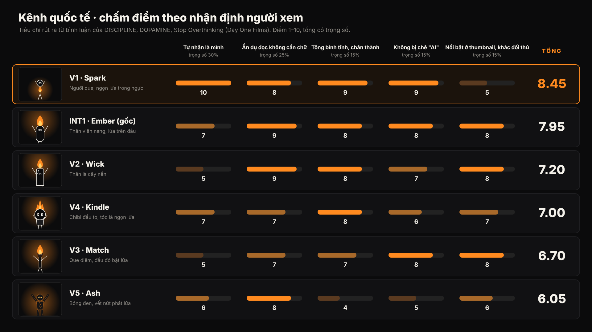

# Kênh quốc tế: 5 biến thể nhân vật và chấm điểm theo nhận định người xem

## Người xem quốc tế nói gì (bình luận trên Day One Films)

Đọc bình luận của DISCIPLINE, DOPAMINE và Stop Overthinking, có 5 điều lặp lại. Mỗi điều được dùng làm một tiêu chí:

| Tiêu chí | Trọng số | Bằng chứng từ bình luận |
|---|---|---|
| **Tự nhận là mình** | 30% | "Literally me", "this is the exact depiction of my life", "most relatable thing I've ever seen", "It's YOU vs YOU" (1k like) |
| **Ẩn dụ đọc được không cần chữ** | 25% | "using colour as the thing the phone slowly steals is such a clean idea", "the red notes, the invisible voice", subtitle hiện phiên bản tích cực (478 like) |
| **Tông bình tĩnh, chân thành** | 15% | "No phonk, no motivation, no voiceover but still pure advice", "your videos are beautiful & calm" |
| **Không bị chê "AI"** | 15% | Có người comment "is AI…", "Ai video" ngay dưới video |
| **Nổi bật ở cỡ thumbnail, khác đối thủ** | 15% | "the power of the red band is insane": người xem nhớ món đồ nhận diện |

Khán giả chủ yếu là học sinh, sinh viên và người trẻ (Ấn Độ, Mỹ, Đức, Đông Âu), nhiều người có social anxiety. Họ cũng ngạc nhiên vì "a stickman video can motivate me". Nghĩa là sự đơn giản là điểm cộng, không phải điểm trừ.

## Kết quả

| Hạng | Biến thể | Điểm | Nhận xét theo góc nhìn người xem |
|---|---|---|---|
| 1 | **V1 Spark**: người que, lửa trong ngực | **8.45** | Người que "trống" nên ai cũng thấy mình trong đó. Lửa trong tim là thành ngữ "inner fire" mà mọi nền văn hoá đều hiểu. Tông nhẹ nhàng, nét tay nên khó bị chê AI. **Điểm yếu:** nhìn rất giống nhân vật của Day One Films, và ở cỡ thumbnail ngọn lửa nhỏ, khó thấy. |
| 2 | **Ember (gốc)**: thân viên nang, lửa trên đầu | 7.95 | Cân bằng nhất: lửa to, đọc ngay ở thumbnail, khác hẳn đối thủ. Thân viên nang hơi "là một nhân vật", nên người xem kém tự nhận là mình hơn người que. |
| 3 | **V2 Wick**: cây nến | 7.20 | Ẩn dụ rất mạnh (sáp chảy là thời gian trôi). Nhưng người xem khó thấy mình là một cây nến, và hợp với các chủ đề thời gian, hối tiếc hơn là kỷ luật nói chung. |
| 4 | **V4 Kindle**: chibi, tóc lửa | 7.00 | Dễ thương, hợp với học sinh cấp 2. Nhưng phong cách chibi đang tràn ngập ở các kênh AI nên dễ bị gắn mác "AI". Tóc lửa cũng hơi giống nhân vật anime có sẵn. |
| 5 | **V3 Match**: que diêm | 6.70 | "Quẹt diêm = Day 1" rất đẹp cho một video. Nhưng que diêm chỉ cháy được một lần, mâu thuẫn với thông điệp "giữ lửa mỗi ngày", nên khó làm thành series. |
| 6 | **V5 Ash**: bóng đen, vết nứt lửa | 6.05 | Ngầu, hợp gu "aura/sigma edit". Nhưng người xem kênh này khen đúng điều ngược lại: không phonk, nhẹ nhàng. Kiểu bóng đen phát sáng cũng dễ bị coi là edit AI. |

Các thẻ so sánh buông thả và kỷ luật của từng biến thể:
`concept/int-v1-spark.png`, `concept/int-v2-wick.png`, `concept/int-v3-match.png`, `concept/int-v4-kindle.png`, `concept/int-v5-ash.png`.

## Đề xuất

**Ghép V1 và Ember: người que Spark, lửa nhỏ trong ngực, và khi kỷ luật thì lửa lan lên thành ngọn lửa trên đầu.**

- Giữ được điểm cao nhất của V1: người xem tự nhận là mình.
- Lấy lại điểm mạnh của Ember: ngọn lửa trên đầu to, nổi ở thumbnail, khác Day One Films (họ dùng băng đô đỏ).
- Cơ chế kể chuyện rõ hơn: lửa từ trong tim (ý chí) lan ra ngoài (hành động). Cảnh kết là ngọn lửa bùng trên đầu.

## Lưu ý

- Điểm số là đánh giá của mình dựa trên bình luận thật, **chưa phải dữ liệu thử nghiệm**.
- Cách kiểm chứng rẻ nhất trước khi làm video dài:
  1. Làm 2–3 Shorts 15 giây, mỗi Short một nhân vật (Spark, Ember, bản ghép), cùng một chủ đề. Xem tỷ lệ xem hết và tỷ lệ bấm thích.
  2. Khi kênh đủ điều kiện, dùng **Test & Compare** của YouTube Studio để thử thumbnail giữa hai nhân vật trên cùng một video.
