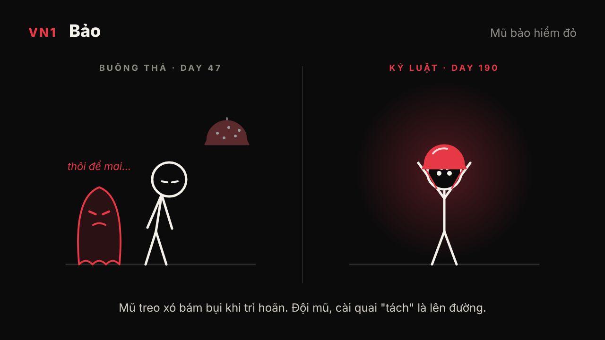
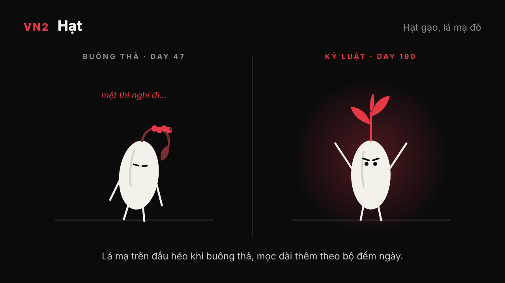
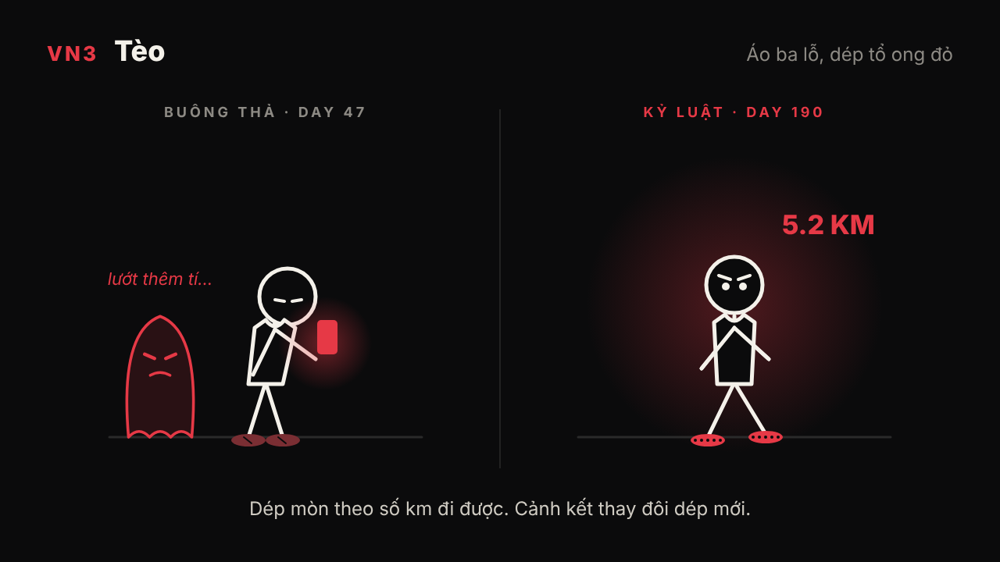
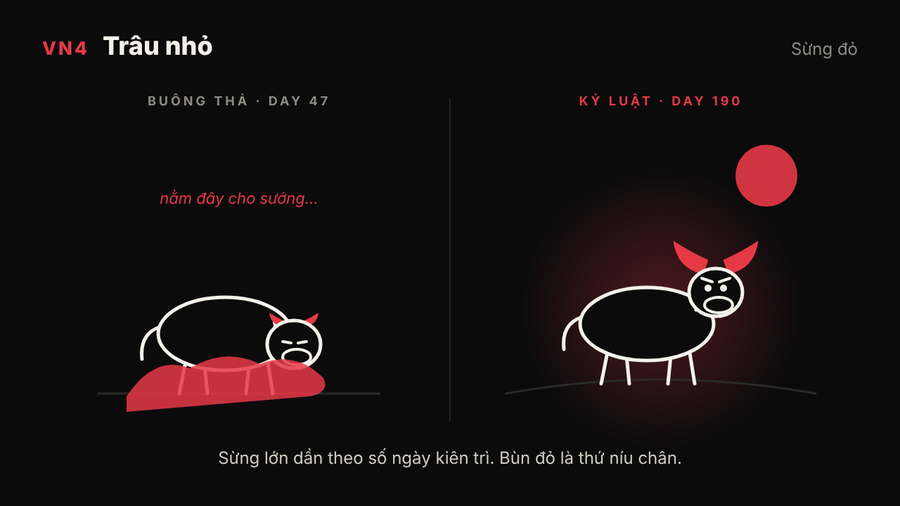
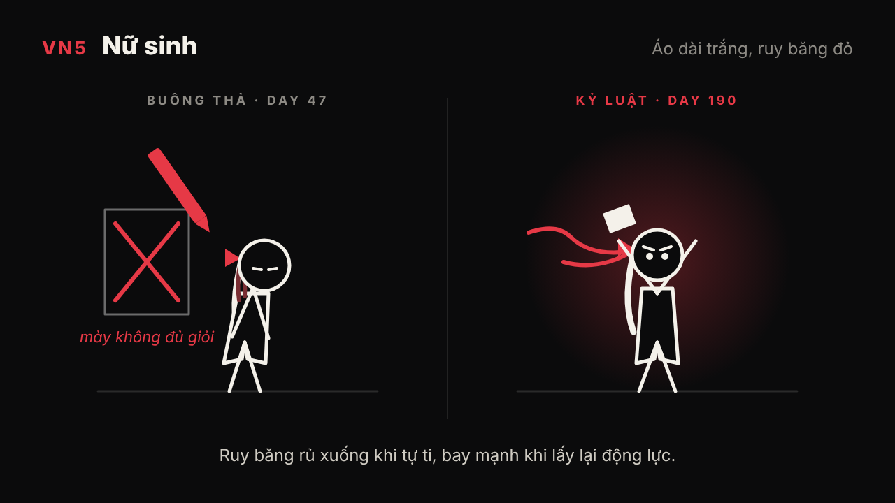
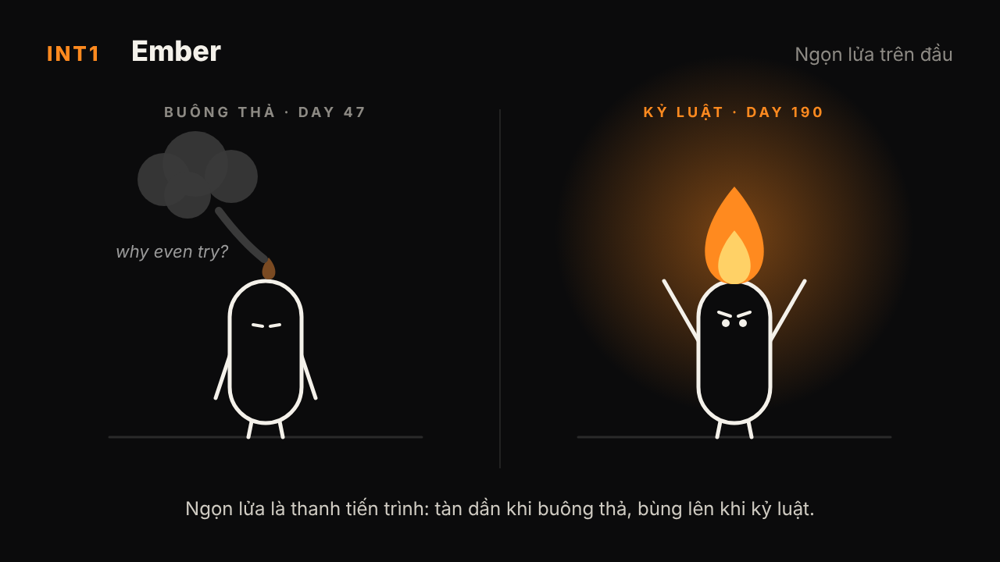
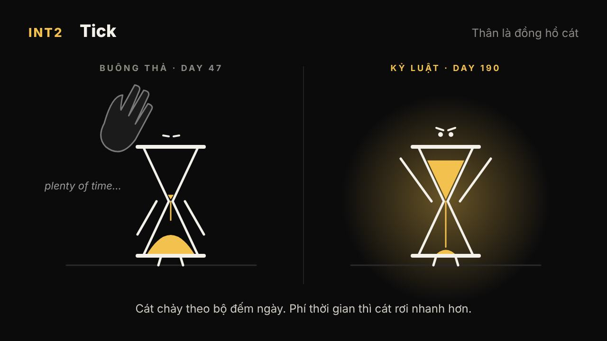
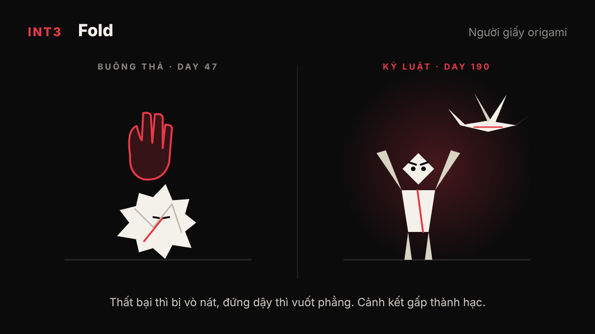
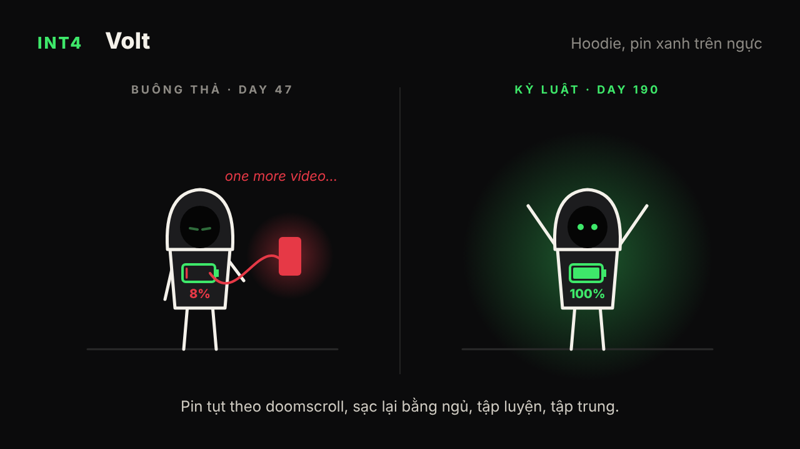
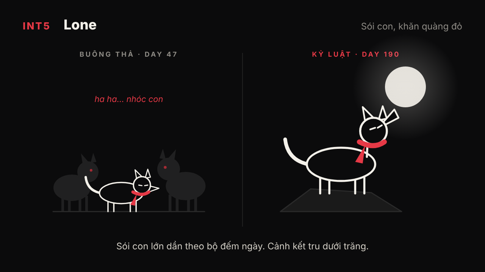

# Phương án nhân vật chính

> Đã chốt: **VN1 Bảo** và **INT1 Ember**. Xem `thiet-ke-nhan-vat.md`.

Nguyên tắc chung cho cả hai kênh:

- **Một hình dạng đơn giản**, vẽ lại được ở mọi góc mà AI không làm lệch.
- **Một dấu hiệu nhận diện** mang màu nhấn duy nhất (vai trò của băng đô đỏ).
- **Một cơ chế hình ảnh** cho người xem thấy tiến bộ mà không cần lời.
- **Con quỷ** cùng màu nhấn, hình dạng đổi theo từng chủ đề.

Ảnh concept vẽ tay bằng vector (`concept/`, tạo lại bằng `node concept/ve-concept.js <thư mục ra>`).
Prompt tiếng Anh ở mỗi phương án dùng để tạo ảnh mẫu; giữ nguyên đoạn
`style lock` ở cuối để các cảnh đồng bộ.

---

## Kênh Việt Nam

### VN1. "Bảo" và chiếc mũ bảo hiểm đỏ

- **Tạo hình:** người que trắng thân hạt đậu, luôn đội mũ bảo hiểm xe máy nửa đầu màu đỏ.
- **Vì sao hợp:** mũ bảo hiểm là thứ người Việt nào cũng có, nhìn là nhận ra ngay. Đội mũ = "lên đường", bỏ mũ treo xó = bỏ cuộc.
- **Cơ chế:** mũ bám bụi khi trì hoãn, sáng bóng khi kỷ luật. Cảnh kết là cài quai mũ "tách".
- **Con quỷ:** cái bóng đỏ ngồi sau xe, thì thầm "thôi để mai".
- **Hợp ngách:** đi làm, kiếm tiền, mưu sinh, tự lập.
- **Prompt:** `minimalist 2D stick figure, white rounded bean-shaped body, wearing a red half-face motorbike helmet, pure black background, thin white outline, single red accent color, simple expressive eyes, flat vector, Vietnamese street at night silhouette`

### VN2. "Hạt" — hạt gạo nhân hóa

- **Tạo hình:** hạt gạo trắng có tay chân que, trên đầu có một vệt đỏ hình chiếc lá mạ.
- **Vì sao hợp:** hạt gạo gắn với lao động, gia đình, "một nắng hai sương". Rất hợp cho ngách cha mẹ và tiết kiệm.
- **Cơ chế:** lá mạ trên đầu héo khi buông thả và mọc dài thêm theo bộ đếm ngày.
- **Con quỷ:** con sâu đỏ gặm lá.
- **Hợp ngách:** gia đình, tiết kiệm, quê hương, lập nghiệp.
- **Prompt:** `cute minimalist character shaped like a single white rice grain with thin stick arms and legs, small red rice-seedling leaf on top of its head, pure black background, flat 2D vector, soft white glow, one red accent color`

### VN3. "Tèo" áo ba lỗ dép tổ ong

- **Tạo hình:** người que trắng mặc áo ba lỗ, đi dép tổ ong màu đỏ.
- **Vì sao hợp:** chất bình dân, gần gũi, pha chút hài. Khác hẳn tông "sigma" nghiêm túc của các kênh ngoại.
- **Cơ chế:** dép mòn dần theo số km đi bộ hoặc chạy. Cảnh kết thay đôi dép mới.
- **Con quỷ:** cái võng đỏ hoặc chiếc điện thoại đỏ níu lại.
- **Hợp ngách:** lười, điện thoại, thói quen xấu, tài chính kiểu TTTT.
- **Prompt:** `minimalist white stick figure wearing a sleeveless tank top and red Vietnamese honeycomb plastic sandals, pure black background, flat 2D vector, humorous but heartfelt tone, single red accent color`

### VN4. "Trâu nhỏ"

- **Tạo hình:** chú trâu con tối giản màu trắng, sừng nhỏ màu đỏ.
- **Vì sao hợp:** con trâu là biểu tượng chăm chỉ, bền bỉ. Mascot con vật dễ làm merch và dễ được trẻ em, phụ huynh chia sẻ.
- **Cơ chế:** sừng lớn dần theo số ngày kiên trì.
- **Con quỷ:** đám bùn đỏ kéo chân xuống.
- **Hợp ngách:** học sinh mùa thi, kiên trì, gia đình.
- **Prompt:** `minimalist white baby water buffalo character, rounded simple shapes, small red horns, pure black background, flat 2D vector, determined expressive eyes, single red accent color`

### VN5. Cô học sinh áo dài trắng, ruy băng đỏ

- **Tạo hình:** nhân vật nữ que tối giản mặc áo dài trắng, buộc tóc bằng ruy băng đỏ.
- **Vì sao hợp:** cân bằng giới tính (ngách này đang toàn nhân vật nam) và rất "Việt". Hợp với ngách học tập và tuổi mới lớn.
- **Cơ chế:** ruy băng bay mạnh hơn khi lấy lại động lực.
- **Con quỷ:** cây bút đỏ gạch xóa, tiếng "mày không đủ giỏi".
- **Hợp ngách:** thi cử, so sánh, áp lực gia đình, tự ti.
- **Prompt:** `minimalist 2D stick figure girl in a white Vietnamese ao dai school uniform, long hair tied with a red ribbon, pure black background, flat vector, thin white outline, single red accent color, gentle determined expression`

---

## Kênh quốc tế

### INT1. "Ember" — ngọn lửa trên đầu

- **Tạo hình:** thân hạt đậu trắng, không mặt chi tiết, trên đầu có ngọn lửa nhỏ màu cam.
- **Cơ chế:** ngọn lửa chính là thanh tiến trình. Nó tàn dần khi buông thả và bùng lên khi kỷ luật, người xem nhìn là hiểu ngay.
- **Con quỷ:** làn khói xám đen muốn dập lửa.
- **Hợp ngách:** kỷ luật, động lực, kiệt sức, mất đam mê.
- **Prompt:** `minimalist white bean-shaped character with a small glowing orange flame on top of its head, pure black background, flat 2D vector, the flame is the only color, cinematic lighting`

### INT2. "Tick" — người đồng hồ cát

- **Tạo hình:** thân là một đồng hồ cát, cát màu vàng.
- **Cơ chế:** cát chảy theo bộ đếm ngày. Lãng phí thời gian thì cát rơi nhanh hơn.
- **Con quỷ:** bàn tay đen lật ngược đồng hồ.
- **Hợp ngách:** thời gian, hối tiếc, cha mẹ già, memento mori, trì hoãn.
- **Prompt:** `minimalist character whose body is a glass hourglass with stick arms and legs, glowing golden sand inside, pure black background, flat 2D vector, melancholic yet hopeful mood, gold as the only accent color`

### INT3. "Fold" — người giấy origami

- **Tạo hình:** nhân vật gấp từ giấy trắng, một nếp gấp màu đỏ.
- **Cơ chế:** thất bại thì bị vò nát. Mỗi lần đứng dậy thì vuốt phẳng lại. Cảnh kết gấp thành con hạc bay lên.
- **Con quỷ:** bàn tay đỏ vò giấy.
- **Hợp ngách:** thất bại, bị từ chối, chia tay, tự ti, làm lại từ đầu.
- **Prompt:** `minimalist origami paper character folded from white paper, one red crease line, pure black background, soft paper texture, 2D/2.5D style, single red accent color`

### INT4. "Volt" — cục pin trên ngực

- **Tạo hình:** người mặc hoodie trùm đầu, mặt tối, ngực có biểu tượng pin phát sáng xanh lá.
- **Cơ chế:** phần trăm pin tụt theo doomscroll, dopamine rẻ, thức khuya, rồi sạc lại bằng ngủ, tập luyện, tập trung.
- **Con quỷ:** sợi dây cáp đỏ hút pin từ điện thoại.
- **Hợp ngách:** điện thoại, dopamine, mất ngủ, kiệt sức. Rất hợp với khán giả Gen Z.
- **Prompt:** `minimalist faceless figure in a dark hoodie, glowing green battery icon on the chest showing charge level, pure black background, flat 2D vector, neon green as the only accent color`

### INT5. "Lone" — sói con

- **Tạo hình:** sói con màu trắng tối giản, khăn quàng đỏ.
- **Vì sao hợp:** hút khán giả kiểu "lone wolf, sigma" nhưng mềm và đáng yêu hơn, dễ làm merch.
- **Cơ chế:** sói con lớn dần theo bộ đếm ngày. Cảnh kết tru dưới trăng.
- **Con quỷ:** bầy bóng đen cười nhạo.
- **Hợp ngách:** cô đơn, tự lập, bị coi thường, chứng minh bản thân.
- **Prompt:** `minimalist white wolf cub character, simple rounded shapes, red scarf, pure black background, flat 2D vector, determined eyes, red as the only accent color`

---

## Đề xuất chọn

- **Việt Nam:** VN1 (mũ bảo hiểm) là nhận diện mạnh nhất. VN3 (dép tổ ong) để khác biệt bằng chất hài.
- **Quốc tế:** INT1 (Ember) có cơ chế hình ảnh rõ nhất. INT2 (đồng hồ cát) để mở sang ngách thời gian và gia đình.
- Hai kênh nên khác màu nhấn để không bị coi là reup của nhau. Ví dụ VN dùng đỏ, quốc tế dùng cam lửa.

**Style lock** (dán cuối mọi prompt):
`consistent character design, same proportions every shot, 16:9, no text, no watermark, high contrast, clean minimal composition`
