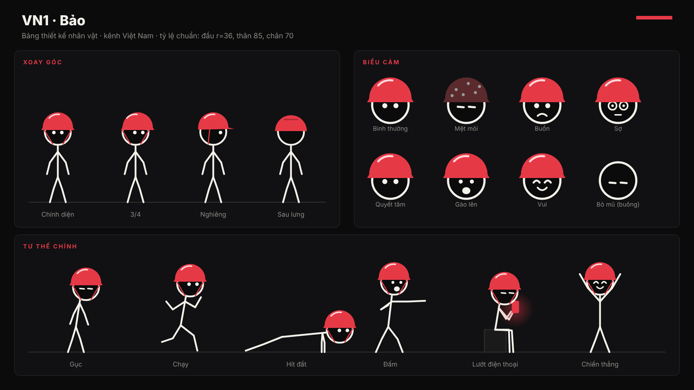
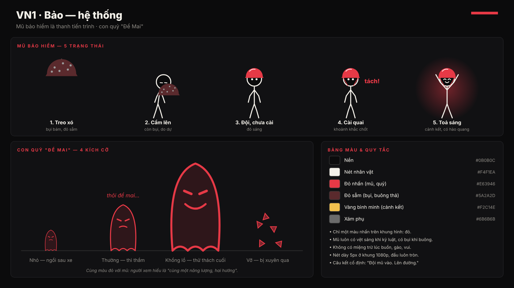
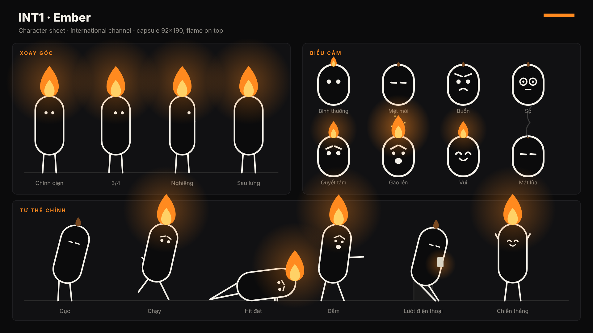
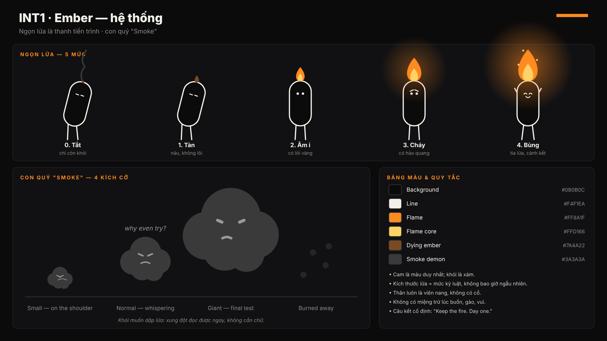

# Thiết kế nhân vật đã chốt

| Kênh | Nhân vật | Món đồ = thanh tiến trình | Con quỷ | Màu nhấn |
|---|---|---|---|---|
| Việt Nam | **Bảo** (VN1) | Mũ bảo hiểm đỏ: bụi → sáng → cài quai | "Để Mai": bóng ma đỏ ngồi sau xe | Đỏ `#E63946` |
| Quốc tế | **Ember** (INT1) | Ngọn lửa trên đầu: tắt → bùng | "Smoke": đám khói xám | Cam `#FF8A1F` |

Bảng thiết kế (vẽ lại bằng `node concept/ve-bang-thiet-ke.js concept`):






---

## Bảo (kênh Việt Nam)

### Thông số
- Người que trắng `#F4F1EA`, nét đều 5px ở khung 1080p, đầu tròn.
- Tỷ lệ: đầu bán kính 36, thân 85, chân 70. Tổng cao khoảng 5,5 lần bán kính đầu.
- Mặt: hai chấm mắt, lông mày ngắn. Chỉ có miệng khi buồn, gào hoặc vui.
- Mũ bảo hiểm nửa đầu đỏ, phủ nửa trên của đầu, không che mắt. Có vệt sáng khi kỷ luật, có chấm bụi khi buông thả. Quai đỏ mảnh nối xuống cằm.

### Mũ bảo hiểm: 5 trạng thái, dùng theo nhịp kịch bản
| Trạng thái | Nhịp dùng |
|---|---|
| 1. Treo xó, bám bụi | Mở đầu, trượt dốc |
| 2. Cầm lên, còn bụi | Bước ngoặt |
| 3. Đội, chưa cài | Đầu montage |
| 4. Cài quai "tách" | Khoảnh khắc chốt: cắt cảnh nhanh, có tiếng tách |
| 5. Toả sáng có hào quang | Cảnh kết |

### Con quỷ "Để Mai"
- Bóng ma đỏ trong suốt, mắt xếch, cười nhếch.
- Lời thì thầm: "thôi để mai", "mai tính", "nghỉ tí đã", "ai cũng thế mà".
- Kích cỡ: nhỏ (ngồi sau xe) → thường → khổng lồ (thử thách cuối) → vỡ vụn khi Bảo lao xuyên qua.

### Câu kết cố định
> **"Đội mũ vào. Lên đường."**

### Prompt nhân vật gốc (ảnh tham chiếu)
```
Character reference sheet, minimalist 2D stick figure named Bao: thin off-white (#F4F1EA) uniform 5px lines, perfectly round head with two small dot eyes and short eyebrows, no mouth, wearing a glossy red (#E63946) half-face motorbike helmet covering only the top half of the head, thin red chin strap, white highlight arc on the helmet. Pure black background (#0B0B0C). Front, 3/4, side and back views side by side, neutral standing pose. Flat vector, no shading, no text, no watermark, high contrast, consistent proportions.
```

### Mẫu prompt cảnh
```
[same character as reference: Bao, minimalist off-white stick figure with red half-face motorbike helmet]
SCENE: {mô tả hành động}, {trạng thái mũ: dusty dark-red helmet hanging on a wall hook | shiny red helmet with highlight}.
{con quỷ nếu có: a translucent red ghost-shaped shadow with slanted eyes sitting behind him whispering}.
Pure black background, single red accent color, minimal props in thin white line art, cinematic 16:9 composition, flat 2D vector, no text.
```
Ví dụ: `SCENE: Bao lies on a mattress scrolling a glowing red phone at 2 AM, dusty dark-red helmet hanging on a wall hook in the corner, a small translucent red ghost sits on his shoulder whispering.`

---

## Ember (kênh quốc tế)

### Thông số
- Thân viên nang (92×190), không có cổ, nét trắng 5px. Tay chân là nét que mảnh.
- Mặt nằm ở phần trên thân: hai chấm mắt, lông mày ngắn. Chỉ có miệng khi buồn, gào hoặc vui.
- Ngọn lửa đặt trên đỉnh thân, luôn hướng thẳng lên trời kể cả khi thân nghiêng.

### Ngọn lửa: 5 mức
| Mức | Hình dạng | Nhịp dùng |
|---|---|---|
| 0. Tắt | Chỉ còn sợi khói | Chạm đáy |
| 1. Tàn | Nâu `#7A4A22`, không lõi | Trượt dốc |
| 2. Âm ỉ | Cam, có lõi vàng | Bước ngoặt |
| 3. Cháy | Có hào quang | Montage |
| 4. Bùng | Hào quang lớn, có tia lửa | Thử thách cuối, cảnh kết |

Quy tắc: kích thước lửa luôn khớp với mức kỷ luật, không bao giờ thay đổi ngẫu nhiên.

### Con quỷ "Smoke"
- Đám khói xám `#3A3A3A` có mắt, muốn dập lửa.
- Lời thì thầm: "why even try?", "tomorrow", "you're tired", "one more video".
- Kích cỡ: nhỏ (đậu trên vai) → thường → khổng lồ → bị lửa đốt tan.

### Câu kết cố định
> **"Keep the fire. Day one."**

### Prompt nhân vật gốc (ảnh tham chiếu)
```
Character reference sheet, minimalist 2D character named Ember: a black capsule-shaped body (rounded pill, no neck) with a uniform off-white (#F4F1EA) 5px outline, two small dot eyes and short eyebrows in the upper part, no mouth, thin stick arms and legs, a bright orange (#FF8A1F) flame with a yellow (#FFD166) core burning on top of its head, soft orange glow. Pure black background (#0B0B0C). Front, 3/4, side and back views, neutral standing pose. Flat vector, no shading, no text, no watermark, consistent proportions.
```

### Mẫu prompt cảnh
```
[same character as reference: Ember, black capsule body with off-white outline and a flame on its head]
SCENE: {action}, flame level {0 smoke only | 1 tiny brown ember | 2 small flame with yellow core | 3 bright flame with glow | 4 huge blazing flame with sparks}.
{demon if any: a dark grey smoke cloud with angry eyes trying to smother the flame}.
Pure black background, orange as the only accent color, minimal props in thin white line art, cinematic 16:9, flat 2D vector, no text.
```
Ví dụ: `SCENE: Ember sits on a couch at night staring at a phone, flame level 1 tiny brown ember, a grey smoke cloud with angry eyes hovers above, ready to smother it.`

---

## Quy trình giữ nhân vật đồng nhất khi làm bằng AI

1. Tạo **ảnh tham chiếu gốc** từ prompt nhân vật gốc. Chọn một ảnh đẹp nhất và dùng nó làm tham chiếu cho mọi cảnh sau. Có thể dựng lại bằng vector theo bảng thiết kế để có bản chuẩn tuyệt đối.
2. Mỗi cảnh luôn đính kèm ảnh tham chiếu (tính năng character reference của công cụ tạo ảnh hoặc video) và dùng đúng mẫu prompt cảnh ở trên.
3. Chỉ thay đổi ba biến trong prompt: **hành động**, **trạng thái món đồ**, **con quỷ**. Không đổi mô tả nhân vật.
4. Tạo ảnh tĩnh trước rồi mới tạo chuyển động (image-to-video). Chuyển động ngắn 3–5 giây mỗi cảnh, góc máy cố định.
5. Kiểm tra mỗi cảnh theo bảng thiết kế: mũ không che mắt, lửa luôn hướng lên, chỉ một màu nhấn trong khung hình.
